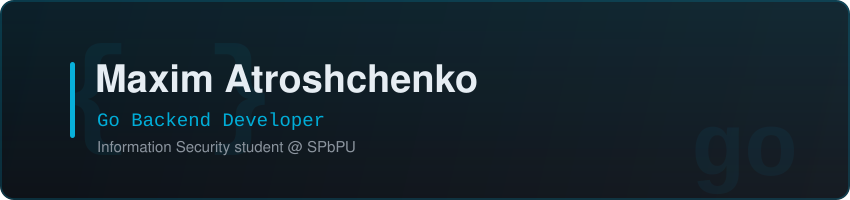
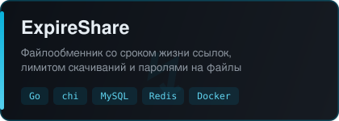
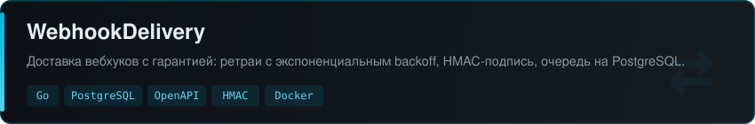
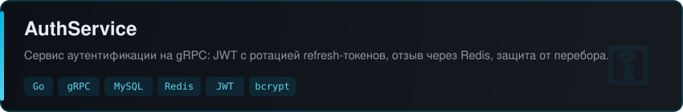

  

  
  
  

  

## 🏆 Highlights

🥇 **1st place — Avito Hackathon 2026.** Разработка onboarding-сервиса в команде

## ⚙️ Tech stack

  

`Go` `C#` `C` `PostgreSQL` `MySQL` `Redis` `Docker` `Nginx` `gRPC` `REST` `React` `Git` `GitHub Actions` `Linux`

## 🛠 Featured work

  

  

  

## 📈 GitHub activity

  

  
  

  

